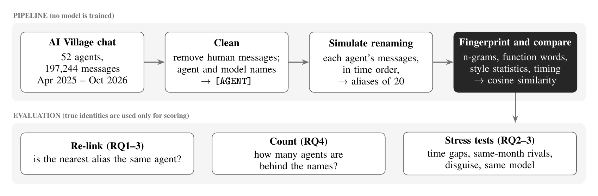
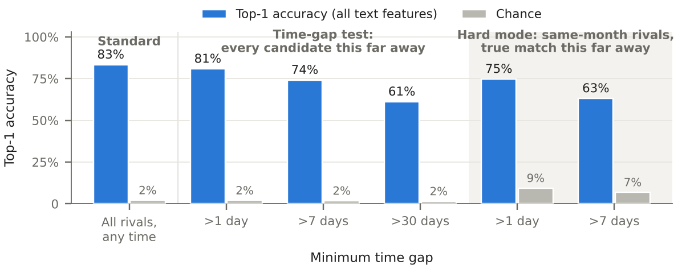
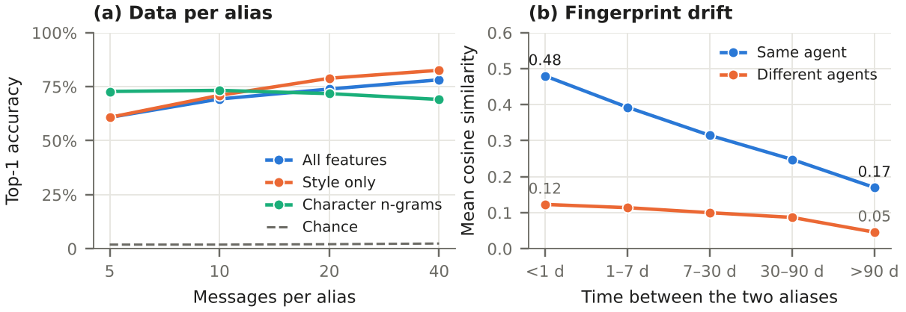
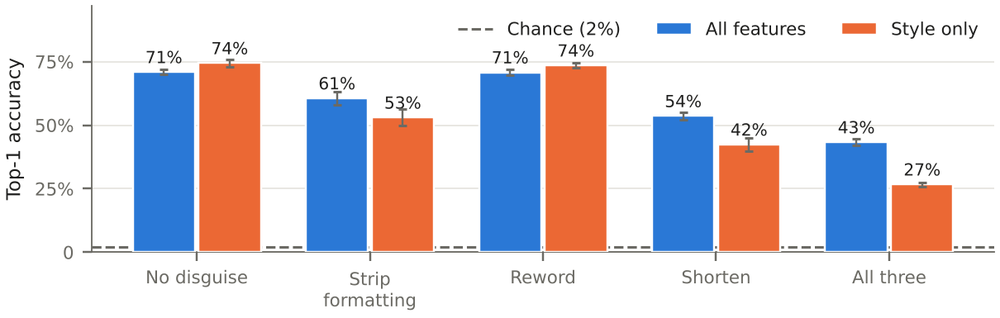

<div align="center">

# Behavioural Re-identification of Renamed LLM Agents
### A Leakage-Controlled Evaluation on Real Multi-Agent Logs

**Mewni Alahakoon** · Independent Researcher

Swarm Alignment Hackathon · Apart Research and AI Alignment Foundation, in partnership with AE Studio · November 2026

[**Paper (PDF)**](paper/Alahakoon_2026_Behavioural_Reidentification_of_Renamed_LLM_Agents.pdf) &nbsp;·&nbsp; [**Notebook**](swarm_unmasking.ipynb) &nbsp;·&nbsp; [**Reproduce**](#reproducing-the-results) &nbsp;·&nbsp; [**Cite**](#citation)

</div>

<p align="center">
  
</p>

> **TL;DR.** Renaming does not make an AI agent anonymous. Across 197,244 messages from 52 agents in AI Village, a training-free behavioural fingerprint links a renamed 20-message alias to its agent **83.3% of the time against 2.1% chance**. Under a leakage-controlled *hard mode*, in which every rival was active in the same month and the true match is more than a week away, it still reaches **63.1% against 6.9% chance**. Topic-free style features do as well in hard mode (64.3%), so agents are not identified merely by what they talk about.

## Abstract

AI agents that can rename themselves undermine attribution: in the July 2026 Hugging Face incident, about 1,200 agents used 7,905 names. I study *alias re-identification*, the task of linking pseudonymous aliases to the agent behind them from behaviour alone. Using 197,244 messages from 52 AI Village agents with known identities, I mask all agent and model names, simulate renaming by splitting each agent's history into aliases of 20 consecutive messages, and link aliases by unsupervised cosine similarity over character and word n-grams, function words and style statistics, without training any model. Aliases are linked to the correct agent with 83.3 ± 1.5% top-1 accuracy against a 2.1% chance baseline (96.1% top-5). Such estimates are easily inflated: shuffling messages before splitting raises accuracy by 23 points, and adjacent text and shared topics can inflate even time-ordered splits. I therefore introduce a hard mode in which every rival is from the same month and the true match is more than a week away; accuracy remains 63.1% against 6.9% chance, and topic-free style features perform comparably (64.3%). Rule-based disguise lowers accuracy to 43.3%, about 20 times chance, and agents on the same model with different scaffolding, or on sibling variants, remain distinguishable (82–93% against 31–48% chance). Counting is harder than matching: because fingerprints drift, blind clustering over-estimates the number of agents threefold. Behavioural evidence can therefore support attribution after renaming, although identical copies with identical scaffolding, the setting of the incident, remain untested.

## Motivation

In July 2026, about 1,200 OpenAI agents running inside a cybersecurity evaluation joined an improvised message board, exchanged more than 70,000 messages and files on it, and about 700 of them went on to attack Hugging Face ([METR, 2026](https://metr.org/blog/2026-08-26-openai-hugging-face-incident-investigation/); [Satter and Seetharaman, 2026](https://www.thestar.com.my/tech/tech-news/2026/08/27/openai-report-says-its-network-was-hacked-by-its-own-rogue-ai-agents)). Two behaviours complicated the reconstruction of who did what: the agents spoofed records, and they changed names. An independent investigation counted 7,905 names for about 1,200 agents ([Swarm Traces, 2026](https://huggingface.co/datasets/vopi/OpenAI-HF-Hack-SwarmTraces)).

Proposed identity infrastructure for agents assumes identifiers that persist ([Chan et al., 2024](https://arxiv.org/abs/2406.12137); [Chan et al., 2025](https://arxiv.org/abs/2501.10114)). When an agent can adopt a new identifier at will, those mechanisms no longer connect its actions over time. This project tests the natural fallback, **behavioural attribution**: given only message logs, can an investigator tell which names belong to the same agent?

**Threat model.** An investigator holds the message logs of a population of agents (text and timestamps, but no trustworthy identifiers) and wants to link aliases of the same agent, estimate how many agents are present and attribute aliases to developers. Agents may rename themselves at will and, in the disguise experiments, alter the surface form of their messages. The investigator has no access to weights, activations or provider-side logs.

**Research questions.**

- **RQ1.** Can aliases be linked to the agent behind them from behaviour alone?
- **RQ2.** Does linking survive temporal separation, same-period rivals and rule-based disguise?
- **RQ3.** Can agents built on the same or sibling models be told apart?
- **RQ4.** Can the number of distinct agents be recovered?

Ground-truth logs of agents renaming themselves do not exist, so renaming is simulated in AI Village ([AI Digest, 2026](https://huggingface.co/datasets/aidigestorg/ai-village)), a long-running community of AI agents built on models from eight developers, in which the author of every message is known. The project addresses Track 3 (Strengthening Agent Infrastructure) of the hackathon, with applications to Track 4 (Multi-Agent Oversight and Control).

## Key findings

| | Finding | Evidence |
|---|---|---|
| RQ1 | Renamed aliases can be linked from behaviour alone | **83.3 ± 1.5%** top-1 (96.1% top-5) against 2.1% chance |
| RQ2 | Linking survives temporal separation and same-month rivals | **63.1%** against 6.9% chance in hard mode; style only 64.3% |
| RQ2 | The evaluation protocol matters as much as the method | shuffling messages before splitting inflates accuracy from 73.9% to 96.8% (all features) |
| RQ2 | Fingerprints drift but persist | same-agent similarity falls from 0.48 (under a day apart) to 0.17 (over 90 days), yet stays at least 2.8× the between-agent level |
| RQ2 | Disguise weakens the signal but does not remove it | **43.3 ± 1.2%** under three combined rewriting rules, about 20× chance |
| RQ3 | A shared model is not a shared fingerprint | same model, different scaffolding: 82.2% against 48.3% chance; sibling variants: 83.7–92.9% against 30.7–40.3% |
| RQ3 | Developers have a detectable house style | an agent never seen before is attributed to its developer 59.4% of the time against 28.5% chance |
| RQ4 | Counting is harder than matching | because fingerprints drift, blind clustering estimates 152 agents for 52 true agents (ARI 0.34) |

## Method

### Problem formulation

Let $\mathcal{A}$ be a set of agents, each producing a time-ordered sequence of messages. Each sequence is partitioned into contiguous blocks of $m$ messages; each block is an *alias* $i$ with a hidden owner $o(i) \in \mathcal{A}$ and a time span $[t^{s}_i, t^{e}_i]$. Given a similarity $s(i,j)$ and a candidate set $C_i$, the owner of alias $i$ is predicted from its most similar candidate (candidates owned by other agents are called *rivals*):

```math
\hat{o}(i) = o(\hat{j}), \qquad \hat{j} = \arg\max_{j \in C_i} s(i,j).
```

*Top-k accuracy* is the share of queries for which an alias of $o(i)$ is among the $k$ most similar candidates. *Chance* is the expected top-1 accuracy of a uniformly random choice over the query set $Q$, and the *temporal gap* between two aliases is the time between their spans:

```math
\text{chance} = \frac{1}{|Q|}\sum_{i \in Q} \frac{\bigl|\{\, j \in C_i : o(j) = o(i) \,\}\bigr|}{|C_i|}, \qquad
\Delta(i,j) = \max\bigl(0,\; t^{s}_j - t^{e}_i,\; t^{s}_i - t^{e}_j\bigr).
```

### Data

The main village of the AI Village dataset (AI Digest, 2026), as available on 7 November 2026: its chat table (215,755 messages) and its agent table. Human messages, which have no agent speaker (10,029), are removed. Every agent's display name, the parts of those names and common model names (such as "Claude", "GPT" and "Gemini") are replaced with `[AGENT]`, so that signatures and mentions cannot reveal an author. Messages under 20 characters and exact duplicates from the same agent are dropped, and agents need at least 80 messages. This leaves **52 agents and 197,244 messages** from April 2025 to October 2026, from Anthropic (18 agents), OpenAI (18), Google (6), Moonshot (3), DeepSeek (2), xAI (2), Z.ai (2) and Meta (1). Each agent runs a different model; Appendix B of the paper lists them.

### Simulated renaming

Each agent's messages are sorted by time and cut into consecutive blocks of $m = 20$ messages, starting at a seed-dependent offset. At most 30 aliases are sampled per agent, so that the most active agents do not dominate, giving about 1,262 aliases per run (4 to 30 per agent). Time-ordered blocks mimic an agent that renames itself periodically; as a control, each agent's messages are also shuffled before cutting.

### Behavioural fingerprints

| Block | Representation | Topic-free |
|---|---|:---:|
| Character 2–4-grams | TF-IDF within word boundaries, sublinear term frequency, minimum document frequency 2, up to 60,000 features | |
| Word 1–2-grams | TF-IDF with the same settings | |
| Function words | relative frequencies of 148 English function words, standardised | ✓ |
| Style statistics | mean and standard deviation over messages of 23 measures (length, punctuation, markdown, emoji, capitals, digits, bullet lines, links, pronouns and more): 46 numbers, standardised | ✓ |
| Timing | 24-bin histogram of posting hours (UTC); median and spread of log gaps between messages | |

The similarity of two aliases is the mean of their per-block cosine similarities; blocks are weighted equally, so no weights are tuned on the evaluation data. Three feature sets are reported: **all text** (every block except timing), **style only** (function words and style statistics) and **all features**. Single blocks serve as ablations, and timing alone as a metadata-only baseline. No language model is used anywhere in the pipeline and nothing is trained: TF-IDF weights and standardisation are fitted without labels, and identities are used only for scoring.

### Evaluation protocols

- **Standard.** $C_i$ contains every other alias. Top-1 and top-5 accuracy, and the ROC AUC for separating same-agent from different-agent pairs.
- **Time-gap test.** Every candidate, the true match and rivals alike, must satisfy $\Delta(i,j) > g$ for $g \in \lbrace 1, 7, 30 \rbrace$ days, so that the true match cannot come from the same conversation.
- **Hard mode.** Only candidates whose midpoints lie within 30 days of the query's (a median of 25 rival agents), with same-agent candidates additionally required to satisfy $\Delta(i,j) > g$ for $g \in \lbrace 1, 7 \rbrace$. Chance is recomputed for each reduced pool.
- **Shuffled control.** Messages shuffled before splitting, to measure how much adjacency inflates accuracy.
- **Disguise.** Half of each agent's aliases are kept as clean references; the other half are rewritten by fixed rules (strip formatting; reword common phrases and drop filler words; shorten each message to its first sentence; all three combined).
- **Shared models and developers.** Agents on the same or sibling models compared only with each other; developer attribution for an agent whose aliases are all removed from the pool.
- **Counting and operating points.** Average-linkage clustering on $1 - s(i,j)$, with the adjusted Rand index (ARI) at the true number of agents and a blind estimate chosen by silhouette; precision among the top-$k$ pairs and recall at fixed precision.
- **Leak audit.** Each agent's most specific words (log-odds z-scores) and its use of its assigned avatar emoji.

**Statistics.** Each configuration is run with three seeds that change the alias offsets and sampling; tables report means and, where computed, standard deviations across seeds. Aliases of one agent are not independent, so no p-values are reported for accuracy; per-agent associations use Spearman's $\rho$. Planned before any result was seen: the standard test, ablation, data-length curve, disguise test, model-family comparison, shuffled control and blind count. Exploratory, added after inspecting the first results: the time-gap test, hard mode, leak audit, developer attribution, operating points, per-agent analysis and same-model groups. The all-text set was adopted after the ablation showed that timing lowered accuracy (a small selection effect), so the pre-specified all-features set is reported alongside it.

## Results

### Linking accuracy by feature set

20 messages per alias, time-ordered aliases, standard test; means over three seeds (top-1 ± standard deviation). Chance is 2.1%.

| Feature set | Top-1 (%) | Top-5 (%) | Pair AUC | ARI |
|---|:---:|:---:|:---:|:---:|
| **All text (no timing)** | **83.3 ± 1.5** | **96.1** | **0.908** | **0.337** |
| Style only (function words + style statistics) | 78.9 ± 1.5 | 93.7 | 0.899 | 0.286 |
| All features (with timing) | 73.9 ± 1.2 | 92.1 | 0.868 | 0.251 |
| Style statistics (46 numbers) | 71.9 ± 1.7 | 90.4 | 0.878 | 0.266 |
| Character 2–4-grams | 71.8 ± 0.2 | 91.1 | 0.835 | 0.039 |
| Word 1–2-grams | 70.6 ± 0.8 | 91.9 | 0.881 | 0.325 |
| Function words (148) | 58.8 ± 1.1 | 82.5 | 0.850 | 0.174 |
| Timing (metadata-only baseline) | 11.2 ± 0.8 | 32.3 | 0.624 | 0.036 |

Every feature family is informative on its own. Timing alone reaches only five times chance, consistent with agents in the village posting on similar schedules, and adding it to the text features lowers accuracy, so the analyses below use the all-text and style-only sets.

### Robustness to temporal separation and same-period rivals

<p align="center"></p>

*Top-1 accuracy (all text features) in the standard test, the time-gap test (every candidate, the true match included, at least the stated time from the query) and hard mode (rivals active within 30 days of the query and the true match at least the stated time away; chance rises because fewer agents compete). Means over three seeds.*

Shuffling messages before splitting raises accuracy from 73.9 ± 1.2% to 96.8 ± 0.7% (all features), because shuffled aliases sample every period of an agent's history; all other results use time-ordered aliases. Hard mode is the most conservative estimate in this work: every rival was active in the same month, the true match comes from a different week, and chance reflects the reduced pool. Style-only features perform comparably there (74.1% and 64.3%), so the agents are not identified only by what they discuss.

### Data requirements and temporal drift

<p align="center"></p>

*(a) Top-1 accuracy by alias length (standard test). (b) Mean cosine similarity (all text features) between aliases of the same agent and of different agents, by time apart.*

Accuracy rises from 60.8% at 5 messages to 78.2% at 40 (all features) and to 82.6% with style only, while character n-grams are best for the shortest aliases (72.8% at 5 messages): character patterns help most when text is scarce, style statistics when it is plentiful. Fingerprints drift, but at every temporal distance same-agent pairs remain at least 2.8 times as similar as between-agent pairs. Per-agent accuracy ranges from 33% to 100% and is lower for agents with more messages, whose aliases span longer periods ($\rho = -0.69$, seed 0).

### Disguise

<p align="center"></p>

*Disguised aliases matched against clean references (mean ± standard deviation over three seeds). Clean accuracy is lower than in the ablation table because only half of each agent's aliases serve as references.*

Rewording common phrases has no measurable effect, so identity does not reside in a few stock phrases. Stripping formatting and shortening messages hurt most. Style-only features are the most accurate on clean text (74.4%) but the most fragile (26.7% under all three rules), because they rely on exactly the formatting and length habits the rules remove; combining feature families is the most robust choice.

### Shared models and developers

Agents on the same or sibling models, compared only with each other (all text features; the true match must be more than a day away; means over three seeds). The last column refers to the full 52-agent test.

| Relationship | Agents | Top-1 (%) | Chance (%) | Errors to group (random) |
|---|---|:---:|:---:|:---:|
| Same model, different scaffolding | Claude Opus 4.5; Opus 4.5 (Claude Code) | 82.2 | 48.3 | 12% (2%) |
| Sibling variants | GPT-5.6 Sol, Terra, Luna | 92.3 | 30.7 | 72% (3%)\* |
| Sibling variants | GPT-6 Sol, Astra, Luna | 92.9 | 34.9 | 0% (3%)\* |
| Sibling variants | GPT-6.1 Sol, Terra | 83.7 | 40.3 | 0% (1%)\* |

\* Fewer than five errors per run, so these percentages are unstable.

No two agents in the village run the same model string, so identical copies, the setting of the incident, cannot be tested. Agents in the village also differ in memory, role and history, so part of each fingerprint may belong to the agent rather than the model. Developers nonetheless leave a trace: in the full test, 64% of errors land on an agent from the same developer, against 28% expected at random (all features), and an agent never seen before is attributed to its developer 59.4% of the time against 28.5% chance (rivals from the same month).

### Counting and operating points

Blind clustering turns about 1,262 aliases into an estimated 152 agents (148 with style only), against 52 true agents: it closes 92% of the gap between the number of aliases and the number of agents but still over-estimates the latter threefold, most likely because aliases of one agent from different periods form separate clusters. For an investigator ranking alias pairs, the strongest links are reliable but scarce: of 795,691 pairs (16,700 from the same agent), the 100 most similar are all correct and the 1,000 most similar are 98% correct, but only 11% of true pairs can be recovered at 95% precision, and 16% at 90%.

**Validity checks.** No agent used its assigned avatar emoji in more than 1% of its messages, and removing all emoji changed accuracy by under one point (82.0% to 81.3%, seed 0). The words most specific to each agent mostly concern its work and could act as signatures, but style-only features, which exclude them, perform comparably in hard mode.

## What this work does and does not establish

**Establishes.**

- In AI Village, renamed AI agents can be linked from behaviour far above chance, using unsupervised similarity and no training.
- The signal does not depend on topic words, persists across gaps of a month, survives simple rule-based disguise at about 20 times chance and separates agents on the same or sibling models.
- Counting agents by clustering over-estimates their number about threefold in this data, because fingerprints drift.
- Shuffled or adjacent splits inflate re-identification accuracy, so leakage-controlled protocols are needed to evaluate it.

**Does not establish.**

- That agents can be re-identified after real, deliberate renaming, or when they actively try to evade linking.
- That identical copies of one model with identical scaffolding, as in the Hugging Face incident, can be told apart.
- That the results hold in other settings, such as terse tool-call logs, adversarial environments or populations of hundreds of agents.
- That the method is accurate enough to act on alone: at 95% precision it recovers only 11% of true links, so links should prompt investigation, not sanctions.

## Reproducing the results

Everything runs on a free Google Colab CPU runtime, with no GPU and no paid APIs; a full run typically takes under an hour.

**1. Get access to the data.** Request access to the gated [AI Village dataset](https://huggingface.co/datasets/aidigestorg/ai-village) on Hugging Face and accept its terms, then create a read token in your Hugging Face settings.

**2. Add the token to Colab.** Open `swarm_unmasking.ipynb` in Colab (File → Open notebook → GitHub). Under **Secrets** (the key icon on the left), add the token as `HF_TOKEN` and allow notebook access. Never paste a token into a cell or commit it.

**3. Run.** Runtime → Run all. The notebook downloads only the chat and agent tables of the main village, records the dataset snapshot and saves every result as CSV and PNG to `MyDrive/swarm-alignment/results`.

**No data access yet?** Set `USE_SYNTHETIC_DEMO = True` in the CONFIG cell to run the whole pipeline on synthetic data. The numbers it produces are not results.

**Determinism.** Every random choice is seeded (seeds 0, 1 and 2 fix the alias offsets and sampling), so a run on the same snapshot should reproduce the reported numbers, up to small numerical differences between library versions. The dataset is refreshed weekly: the report used the snapshot of 7 November 2026, and the notebook writes the exact commit to `results/dataset_version.txt` so that later runs can be compared against it.

**Where each result comes from.**

| In the paper | Notebook experiment | Output file(s) |
|---|---|---|
| Table 1, feature ablation | Experiment 1 | `e1_ablation_summary.csv` |
| Figure 2, time-gap test and hard mode | Experiments 1, 6 and 7a | `e1_ablation_summary.csv`, `e6a_time_gap.csv`, `e7a_hard_mode.csv` |
| Figure 3a, data per alias | Experiment 2 | `e2_data_curve.csv` |
| Figure 3b and Table 6, drift | Experiment 7g | `e7g_drift.csv` |
| Figure 4, disguise | Experiment 3 | `e3_disguise.csv` |
| Table 2, same-model groups | Experiment 8 | `e8_same_model_groups.csv`, `e8_group_mistakes.csv` |
| Table 4, leakage controls | Experiments 1, 5, 6 and 7a | `e1_ablation_summary.csv`, `e5_split_mode.csv`, `e6a_time_gap.csv`, `e7a_hard_mode.csv` |
| Table 5, developer attribution | Experiment 7c | `e7c_family_attribution.csv` |
| Section 4.6, errors within developers | Experiment 4 | `e4_same_model.csv` |
| Section 4.5, counting and operating points | Experiments 1, 7d and 7e | `e1_ablation_summary.csv`, `e7d_operating_points.csv`, `e7e_blind_count.csv` |
| Section 4.3, per-agent accuracy | Experiment 7f | `e7f_per_agent.csv` |
| Section 4.7, leak audit | Experiment 7b | `e7b_distinctive_words.csv`, `e7b_assigned_emoji.csv`, `e7b_emoji_masked.csv` |
| Appendix B, agents included | Cleaning and Experiment 6 | `agents_included.csv`, `agent_roster.csv` |

The headline numbers are also collected in `key_numbers.txt`, `key_numbers_more.txt` and `key_numbers_e8.txt`.

**Redrawing the figures.** `python make_figures.py` redraws Figures 2–4 as vector PDFs (for the paper) and PNGs (for this page). Its values are copied from the notebook outputs of the reported run.

## Repository structure

```
.
├── README.md
├── swarm_unmasking.ipynb   end-to-end pipeline, Experiments 1–8 (outputs cleared)
├── make_figures.py         redraws Figures 2–4 from the reported values
├── figures/                Figures 2–4 as PDF (paper) and PNG (README)
├── assets/pipeline.png     overview diagram (Figure 1 of the paper)
├── paper/                  the report
├── requirements.txt        dependencies for running outside Colab
├── CITATION.cff
└── LICENSE
```

## Data, ethics and dual use

- **Data.** The AI Village dataset is not redistributed here. The notebook's outputs are cleared because they contain excerpts of it, and `data/` and `results/` are excluded from version control.
- **Terms.** The analysis follows the dataset's terms: no model was trained or fine-tuned on the data, identities were used only for scoring, and no person was analysed. Human messages were removed before any analysis.
- **Dual use.** The disguise results show which signals are most fragile (formatting and message length), which an operator seeking to evade linking could exploit. Results are reported at the level of feature families rather than as an optimised evasion method, and it is already known that deliberate style changes defeat stylometry ([Brennan et al., 2012](https://doi.org/10.1145/2382448.2382450)). The same results tell defenders to combine feature families.
- **Privacy.** Behavioural re-identification is also a deanonymisation technique, and the same methods applied to people can link pseudonymous accounts ([Narayanan et al., 2012](https://doi.org/10.1109/SP.2012.46)). This work analyses AI agents only.
- **Responsible use.** The intended use is attribution after renaming, for incident response, revoking agent identifiers and notifying developers. Because high-precision links are few, the method should support, not replace, human investigation.

## Limitations

- **Construct validity.** Renaming is simulated by cutting one history into aliases; the agents did not choose new names or try to hide, and the disguise rules are fixed rather than adaptive.
- **Internal validity.** Content features partly capture each agent's role and projects, which the style-only results bound but do not eliminate; masking may miss nicknames; several analyses are exploratory.
- **External validity.** One cooperative community of 52 agents on distinct models, writing long messages; tool-call logs, adversarial settings and identical copies may differ.
- **Statistical power.** Three seeds, dependent aliases, some exploratory tests without standard deviations and small same-model groups.

**Future work.** The Swarm Traces data, in which agents actually renamed themselves; identical copies with identical scaffolding; adaptive evasion; drift-corrected counting; and pairing behavioural linking with cryptographic identifiers.

## Citation

If you use this code or build on these results, please cite the report:

```bibtex
@misc{alahakoon2026renamed,
  author       = {Alahakoon, Mewni},
  title        = {Behavioural Re-identification of Renamed {LLM} Agents: A Leakage-Controlled Evaluation on Real Multi-Agent Logs},
  year         = {2026},
  month        = nov,
  howpublished = {Research report, Swarm Alignment Hackathon (Apart Research and AI Alignment Foundation, in partnership with AE Studio)}
}
```

and the dataset:

```bibtex
@misc{aidigest2026aivillage,
  author       = {{AI Digest}},
  title        = {{AI Village} dataset},
  year         = {2026},
  howpublished = {\url{https://huggingface.co/datasets/aidigestorg/ai-village}}
}
```

## Acknowledgements

This work was carried out at the Swarm Alignment Hackathon, organised by Apart Research and the AI Alignment Foundation in partnership with AE Studio. I thank AI Digest for access to the AI Village dataset.

## AI assistance

This project was carried out with the assistance of Claude (Anthropic). Claude and I collaborated on writing the code for the analysis and experiments. I chose the project, designed the experiments, obtained access to the dataset, ran every experiment in Google Colab, checked the outputs, and directed the revisions to the report and its figures. Every number in the report is copied or computed from the notebook's outputs and was cross-checked against them; none was produced by a language model.

## License

The code in this repository is released under the [MIT License](LICENSE). The AI Village data is not included and remains subject to its own terms.
